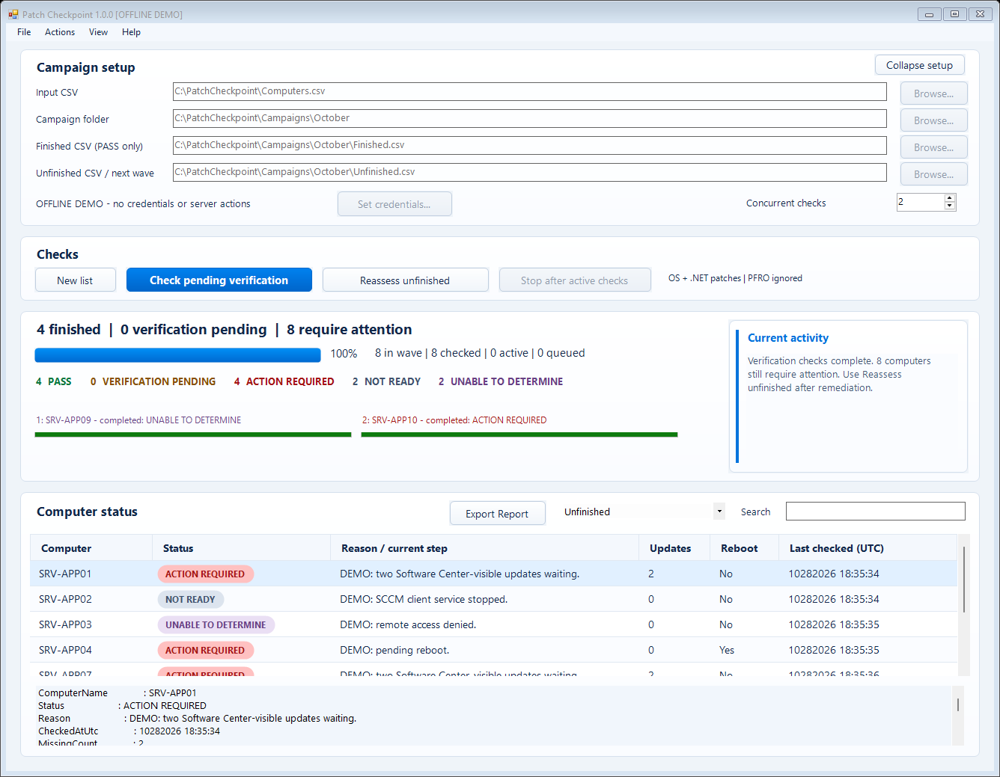

# Patch Checkpoint

**Windows patch and reboot verification, one campaign at a time.**

Give Patch Checkpoint a CSV of Windows computers and see which have finished their
monthly patch cycle, which need attention, and which are still waiting for scan
verification. Keep the results together, resolve issues on the affected machines,
and return for the next check.

**Version 1.0.0** · Windows x64 · SCCM / Configuration Manager

[Download for Windows](https://github.com/Smells-Like-Coffee/PatchCheckpoint/releases/tag/v1.0.0) · [User guide](USER-GUIDE.md) · [Troubleshooting](TROUBLESHOOTING.md) · [Release notes](CHANGELOG.md)



*Actual application running with fictional computers and synthetic demo results.*

## See where your patching stands

- **Clear results:** PASS, VERIFICATION PENDING, ACTION REQUIRED, NOT READY, or UNABLE TO DETERMINE, with a reason for each computer.
- **Focused follow-up:** verify pending computers without repeatedly checking known problems. Reassess unfinished computers after you resolve their issues.
- **Your campaign, your folder:** choose where the working CSVs and resume file are stored. Continue later without changing paths between waves.
- **Useful reports:** export all campaign results to an Excel workbook with a tab per status, or export the current table view to CSV. Excel is not required.
- **Visible progress:** adjustable concurrency, individual check progress, searchable results, and a collapsible setup pane.
- **Support when you need it:** Help > Diagnostic Export creates a local support ZIP with campaign evidence and recent errors, without starting more endpoint checks.

## Get started

1. Download and extract **PatchCheckpoint-1.0.0-Windows-x64.zip** from the release linked above.
2. Open **PatchCheckpoint.exe**. To explore with fictional data, launch it with `-Demo`.
3. Select your input CSV and campaign folder, set credentials, and choose concurrency.
4. Click **Start wave**. The initial assessment includes one automatic verification follow-up after a 60-second scan window.
5. Review the results. Use **Check pending verification** for scans that need more time, or **Reassess unfinished** after you fix reported issues.

Your CSV needs one `ComputerName` or `SERVERNAME` column:

```csv
ComputerName
SERVER01
SERVER02.contoso.com
```

The application creates `Finished.csv`, `Unfinished.csv`, and `Campaign.json` in
your selected folder. Keep these working files intact. Use **Export Report** for a
shareable review copy and **File > Resume campaign** to reopen an older campaign.

## What the results mean

| Status | Meaning |
|---|---|
| **PASS** | A qualifying verification scan completed, and the checked patch/reboot conditions are clear. |
| **VERIFICATION PENDING** | Scan completion has not yet been confirmed. |
| **ACTION REQUIRED** | In-scope patches are outstanding or a checked reboot indicator is present. |
| **NOT READY** | The client is starting, servicing is active, or another readiness condition needs review. |
| **UNABLE TO DETERMINE** | Access or missing evidence prevents a reliable result. |

## Scope and requirements

Patch Checkpoint checks **Software Center-visible Windows OS and .NET patches**,
plus scoped Windows reboot indicators. It ignores PendingFileRenameOperations
(PFRO). Ambiguous update titles require review rather than silently passing.

It **does not install patches or restart computers**. Its only remote state-changing
operation is an SCCM client verification scan; existing SCCM policies still operate
independently. PASS describes the checked conditions, not overall application health.

Run it from a domain-connected Windows administrative computer with **Windows
PowerShell 5.1 and .NET Framework 4.x**, working Kerberos/WinRM access, and an account authorized to read the
targets and request the scan. Targets must have SCCM installed. No extra PowerShell
modules or Excel installation are needed. Follow your organization's script execution
and application-control policies; the EXE and scripts are currently unsigned.

**1.0.0 is the first owner-authorized 1.0 release.** Offline and synthetic GUI tests
cover the workflow, and earlier builds have had owner-run live pilots. Validate the
EXE against a small representative group before broad use. See the [User Guide](USER-GUIDE.md) for
exact scope, permissions, verification rules, and recovery instructions.

## Prefer PowerShell source?

All runnable sources, launchers, examples, tests and EXE build files live in
**[app/](app/)**. Documentation stays at the repository root. Download the
**PatchCheckpoint-1.0.0-Source.zip** package and run **app\\Launch.cmd**; use
**app\\Demo.cmd** for the synthetic demo. The EXE embeds the application files and
does not require the source package beside it. It still uses Windows PowerShell 5.1.

## Built with AI assistance

**AI was used to create this application.** Patch Checkpoint was developed with
OpenAI Codex assistance for implementation, documentation, and test development.
The project owner directs the requirements, review, and operational testing. AI
assistance does not replace code review or validation in your environment.

## More information

[User guide](USER-GUIDE.md) · [Troubleshooting](TROUBLESHOOTING.md) · [Security](SECURITY.md) · [Contributing](CONTRIBUTING.md) · [Changelog](CHANGELOG.md)

Found a problem? [Open an issue](https://github.com/Smells-Like-Coffee/PatchCheckpoint/issues)
with the application version and sanitized reproduction details. Keep credentials,
real computer inventories, and sensitive diagnostic output out of issues.
